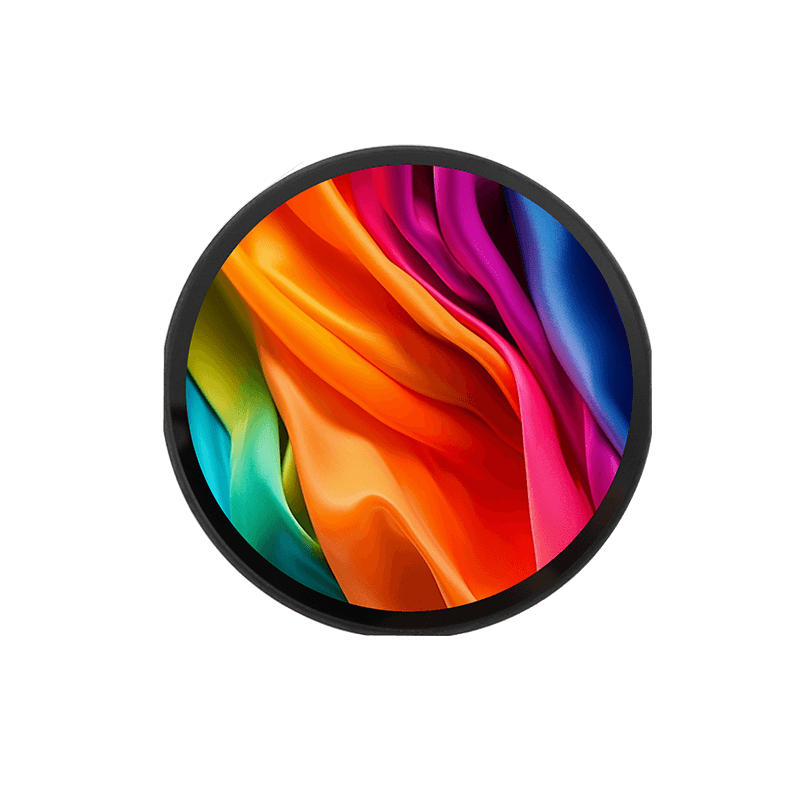

<p align="left"></p>

<h1 align="center">OSPTEK 1.6″ AMOLED 显示屏 480×480（AM160Q480480LK）</h1>

<p align="center"><b>AMOLED 模组 · QSPI · CH13613</b></p>

<p align="center"><a href="./README_EN.md">English</a> | 简体中文 · <a href="../../README.md">规格族索引</a></p>

<p align="center">
  
  
  
</p>

<p align="center"></p>

## 目录

- [规格参数](#规格参数)
- [相关资料](#相关资料)
- [仓库结构](#仓库结构)
- [购买链接](#购买链接)
- [技术支持](#技术支持)

---

## 规格参数

| 项目 | 规格 |
| ---- | ---- |
| 尺寸 | 1.6 英寸 |
| 类型 | AMOLED |
| 分辨率 | 480×480 |
| 外形尺寸 | 41.52 x 41.54 mm |
| 有效显示区域 | 39.12 x 39.12 mm |
| 接口 | QSPI |
| 驱动 IC | CH13613 |
| 触摸驱动 | CHSC6417 |

> 完整外形尺寸、FPC 定义、供电与时序以产品规格书 / 驱动手册为准。

## 相关资料

| 分类 | 文件 |
| ---- | ---- |
| 规格文档 | [`CH_13613_SPEC_V1_0_for_customer_211101_205d382d5a.pdf`](./datasheets/CH_13613_SPEC_V1_0_for_customer_211101_205d382d5a.pdf) |
| 规格文档 | [`DS_CHSC_6417_EU_24_v1_3_1_f66256c159.pdf`](./datasheets/DS_CHSC_6417_EU_24_v1_3_1_f66256c159.pdf) |
| 规格文档 | [`AM_160_Q480480_LK_cb40223812.pdf`](./datasheets/AM_160_Q480480_LK_cb40223812.pdf) |
| CAD 图纸 | [`OK-14F024-04.pdf`](./cad/OK-14F024-04.pdf) |

## 仓库结构

```text
display-amoled-1.6inch-480x480/ # 仓库根（导航见 ../../README.md，示例工程见根目录 examples/）
└── versions/
    └── AM160Q480480LK/        # 本料号完整资料
        ├── README.md
        ├── README_EN.md
        ├── osptek.yml
        ├── images/
        ├── datasheets/       # 产品规格书 + 驱动/触摸 IC 数据手册
        └── cad/              # 外形/盖板 CAD
```

## 购买链接

见[仓库首页](../../README.md#购买链接)。

## 技术支持

见[仓库首页](../../README.md#技术支持)。

---

<p align="center"><sub>© 2026 OSPTEK 鱼鹰光电 · 本仓库资料采用 CC BY 4.0 许可</sub></p>
