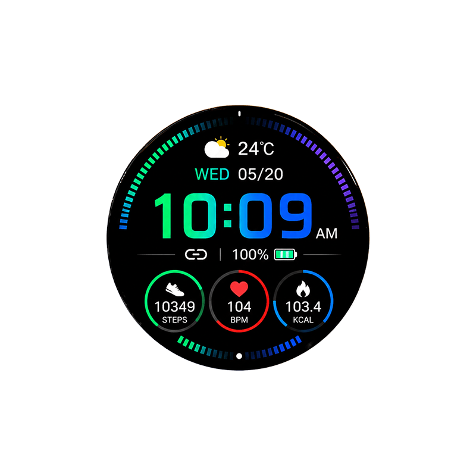

<p align="left"></p>

<h1 align="center">OSPTEK 1.6″ AMOLED Display 480×480 (AM160Q480480LK5)</h1>

<p align="center"><b>AMOLED module · QSPI/MIPI · ST7802</b></p>

<p align="center"><a href="./README.md">简体中文</a> | English · <a href="../../README_EN.md">Family index</a></p>

<p align="center">
  
  
  
</p>

<p align="center"></p>

## Contents

- [Specifications](#specifications)
- [Resources](#resources)
- [Repository layout](#repository-layout)
- [Buy](#buy)
- [Support](#support)

---

## Specifications

| Item | Spec |
| ---- | ---- |
| Size | 1.6 inch |
| Type | AMOLED |
| Resolution | 480×480 |
| Outline | 43.40 x 43.11 mm |
| Active area | 39.12 x 39.12 mm |
| Interface | QSPI/MIPI |
| Driver IC | ST7802 |
| Touch IC | CST9220 |

> Full outline, FPC definition, power, and timing follow the product datasheet / driver IC datasheet.

## Resources

| Category | File |
| ---- | ---- |
| Datasheet | [`AM160Q480480LK5.pdf`](./datasheets/AM160Q480480LK5.pdf) |
| CAD file | [`AM160Q480480LK5.dwg`](./cad/AM160Q480480LK5.dwg) |

## Repository layout

```text
display-amoled-1.6inch-480x480/ # repo root (nav: ../../README_EN.md; sample projects under root examples/)
└── versions/
    └── AM160Q480480LK5/        # full materials for this part number
        ├── README.md
        ├── README_EN.md
        ├── osptek.yml
        ├── images/
        ├── datasheets/       # product datasheet + driver/touch IC datasheets
        └── cad/              # outline/cover CAD
```

## Buy

See the [repo home page](../../README_EN.md#where-to-buy).

## Support

See the [repo home page](../../README_EN.md#support).

---

<p align="center"><sub>© 2026 OSPTEK · Materials in this repository are licensed under CC BY 4.0</sub></p>
